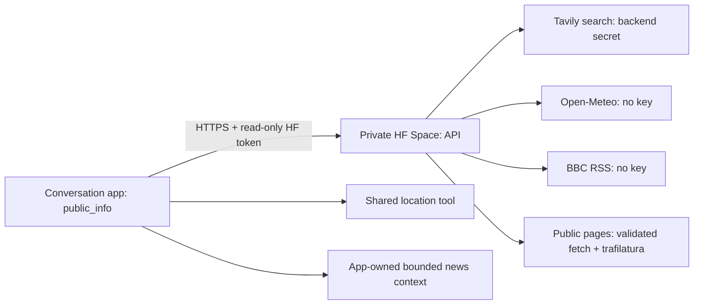

# Phase 2: public information tools

Authorised by Simon on 2026-10-15. Build before asking for keys. **Plan only: no Phase 2 implementation exists.**
Temporarily paused for the update-compatibility audit. Phase 1 motion/quiet integration broke after app 1.1.0
removed our unsupported hooks; it cannot be assumed working or preserved. See [update-compatibility.md](update-compatibility.md).
No app edits, runtime monkey-patching or competing motor writer may be used. Scan/alignment and wake-presence
follow-up remain later work.

The Space is a narrow public-information service, not the private brain. It works when the Mac is off. Only
queries, configured town-level weather location and public article URLs go to this service; no camera or private
memory payloads. `public_info` has explicit search, read, weather, headlines and story operations. Article follow-up
uses cached extracted text and the current question, with source/date/completeness metadata; the conversation
model produces the spoken answer. There is no second agent turn behind the tool.

Files: `public_tools/api.py` defines validated requests/routes, `network.py` bounds and pins public fetches,
`search.py` adapts the harness Tavily lookup, `reading.py` adapts its readable-page extraction, `weather.py` resolves
the shared place and forecast periods, and `news.py` provides stable headline IDs. `robot_tools/public_info.py`
would own the robot adapter/news context. These are proposed files, not implemented modules.
`public_tools/setup.py` would privately deploy/configure/verify the batch through supported settings interfaces.
Keep provider credentials in HF backend Secrets, and the robot's read-only access in a private settings file.

Acceptance is batched: search with dated/source results and explicit missing-key/quota failures; public-page
extraction and safe redirects; location disambiguation/override, today/tomorrow/weekend/seven-day weather;
stable headline numbering across unrelated calls/reloads, chosen-story reading, cached follow-up and unavailable
articles; setup preserving the profile and external state, editing no installed app files, and replacing stock
tools only after live verification. Review context ownership against the supported reload contract before coding.

No key values have been read or migrated. Hosted deployment waits for the user's keys after the build; the
service and robot integration are testable locally without changing working robot tools.
